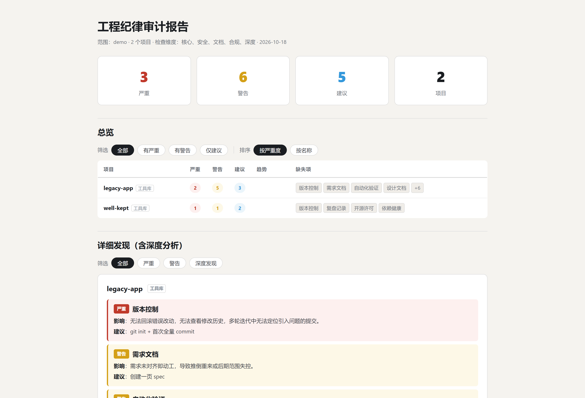

# PULSE · 项目脉搏

> 给你的项目目录做工程纪律体检——一份说人话的 HTML 报告。



管着一堆 AI 辅助开发的项目？PULSE 每周替你把一次脉：谁没有版本控制、谁的测试只是跑了一遍没校验结果、谁带着已知漏洞在运行、谁的需求文档缺"明确不做什么"。两次审计之间自动对比，标出每个项目在改善还是恶化。

## 它查什么

**表面检查**（东西存不存在）：git、需求文档、测试、架构文档、README、协作规范、开源许可……

**深度检查**（东西到底行不行）：

| 检查 | 举例 |
|---|---|
| 提交质量 | 消息是否含糊、一次提交是否混入几十个文件 |
| 测试有效性 | 抽查测试文件，看会不会校验结果对错（而不是占位测试） |
| 需求完整性 | 是否包含四要素：范围、不做什么、验收标准、失败条款 |
| 依赖健康 | 版本锁定、宽松版本号、npm audit 已知漏洞；Python 查版本钉死 |
| 代码体量 | 最大文件行数、超 500 行文件数、待办标记密度 |
| 密钥安全 | 硬编码密钥、被 git 跟踪的敏感文件 |

全部结果分级：**严重 / 警告 / 建议**，每条都写清楚"不修会怎样"和"怎么修"。

## 快速开始

要求：Node.js 14+（git 在 PATH 里时深度检查更完整）。

```bash
git clone https://github.com/israelberne/pulse.git
node pulse/tools/project-audit.cjs --root <你的项目目录>
```

报告生成在 `<你的项目目录>/audits/<日期>/index.html`，浏览器直接打开（file:// 即可，无任何外部依赖）。支持按严重级别筛选、按严重度或名称排序。

### 作为 AI 技能安装

不同工具的技能目录不一样，按你用的选：

```bash
# Claude Code
git clone https://github.com/israelberne/pulse.git ~/.claude/skills/pulse

# ZCode
git clone https://github.com/israelberne/pulse.git ~/.zcode/skills/pulse
```

之后对 AI 说"用 pulse 审计一下我的项目"即可，技能内含完整使用说明。

## 适用范围（先读这个，避免预期错位）

- **项目识别**：Node（含 monorepo / 网页应用 / 服务 / 工具库）、Python、Go、Rust、纯静态站。目录里有 `package.json` / `requirements.txt` / `pyproject.toml` / `go.mod` / `Cargo.toml` / `index.html` 等标志之一才算项目；只有 `src/`、`tools/` 这类子目录的，还得里面有代码文件才认。
- **深度检查的覆盖差异**：依赖漏洞目前只查 npm（需 package-lock.json）和 Python（requirements.txt 钉死）；其他语言做表面检查 + 提交质量等通用深度检查。
- **报告语言**：中文。
- **规则立场**：为"AI 辅助的个人/小团队项目"设计（十条守则：版本控制、需求文档、评测、回滚点……），大团队的完整流程规范未必全部适用。

## 参数

| 参数 | 作用 |
|---|---|
| `--root <dir>` | 要扫描的目录（默认当前目录） |
| `--output <dir>` | 报告输出目录（默认 `<root>/audits`） |
| `--rules a,b,c` | 启用的规则包：core,security,docs,compliance,deep |
| `--fix git,agents,gitignore --confirm` | 自动补齐：git 初始化、协作规范模板、.gitignore |
| `--custom-rules <file.json>` | 自定义"某些文件必须/不能存在"的规则 |
| `--ci` | 有严重问题时退出码 1，配合计划任务做每周门禁 |

自定义规则示例：

```json
[{ "id": "deploy-doc", "name": "部署说明", "severity": "warning",
   "files": ["docs/deploy.md"], "impact": "换机器部署没有步骤可循。", "fix": "补一份部署说明" }]
```

## 试一下

仓库里带了一对演示项目（`demo/`）：一个缺乏约束的旧项目、一个守规矩的小项目。[点这里看现成的示例报告](demo/example-report/report.html)，或自己跑一遍：

```bash
node tools/project-audit.cjs --root demo
```

## 为什么报告要说人话

大部分审计工具的报告是写给机器看的：good/poor、断言覆盖率、lockfile。PULSE 的报告写给**不懂工程的读者**——质量显示"好/一般/差"，测试显示"抽查5个文件，1个会校验结果对错"，项目类型显示"多包项目"而不是 monorepo。规则写在技能说明里，AI 帮你扩展规则时也会遵守。

## 许可

MIT
